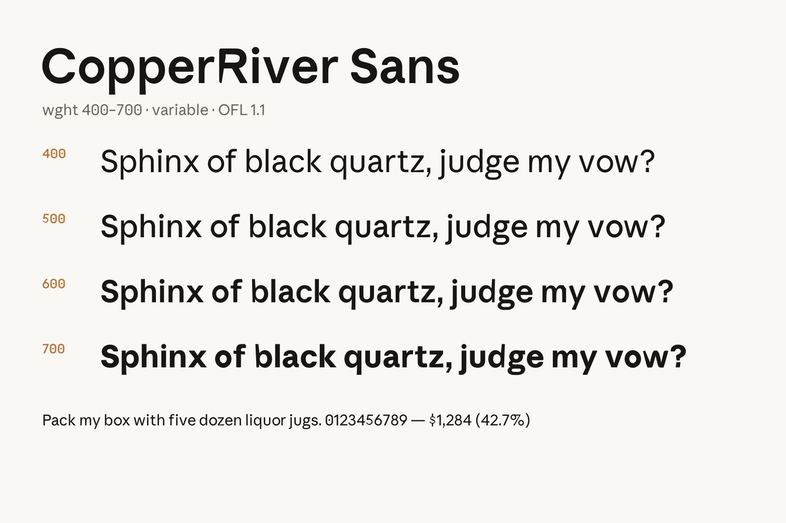

# CopperRiver Sans

An open-source humanist sans-serif typeface for interfaces.

**Live specimen: https://chethankumar.github.io/copperriver-sans/** Warm, slightly
geometric, tuned for UI work at small sizes and comfortable at display sizes.

Derived from [Schibsted Grotesk](https://github.com/schibsted/schibsted-grotesk)
(its outlines were substantially redrawn and metrically reworked), and released
under the SIL Open Font License 1.1.



## What's inside

| Path | Contents |
|---|---|
| `fonts/CopperRiverSans-400.ttf` … `-700.ttf` | Static instances: Regular, Medium, SemiBold, Bold |
| `fonts/CopperRiverSans-VF.ttf` | Variable font, `wght` 400–700 |
| `fonts/web/` | The same fonts as woff2 |
| `index.html` | Animated interactive specimen — open it in any browser; the variable font is embedded, works fully offline |

- 700+ glyphs: LatinExtended-A coverage, currency symbols, punctuation
- Variable `wght` axis (400–700) plus static instances for engines that don't interpolate
- Careful UI spacing: contextual kerning probed behaviorally so words set the same across shapers
- fi/fl ligatures with correct component placement

## Usage

```css
@font-face {
  font-family: "CopperRiver Sans";
  src: url("fonts/web/CopperRiverSans-VF.woff2") format("woff2");
  font-weight: 400 700;
  font-display: swap;
}

body { font-family: "CopperRiver Sans", system-ui, sans-serif; }
```

Or install the TTFs: double-click and choose **Install**, or copy to
`~/Library/Fonts` (macOS) / `%WINDIR%\Fonts` (Windows) / `~/.local/share/fonts` (Linux).

## Development

The shipped TTFs are the working sources — they load directly in FontGoat,
FontForge, or any editor, and can be instanced/recompiled with
[fontTools](https://github.com/fonttools/fonttools).

## License

© 2026 The CopperRiver Sans Project Authors, © 2023 The Schibsted Grotesk
Project Authors.

Licensed under the [SIL Open Font License 1.1](OFL.txt) — free for personal
and commercial use, embeddable in documents and apps, modifiable with the
license intact.
